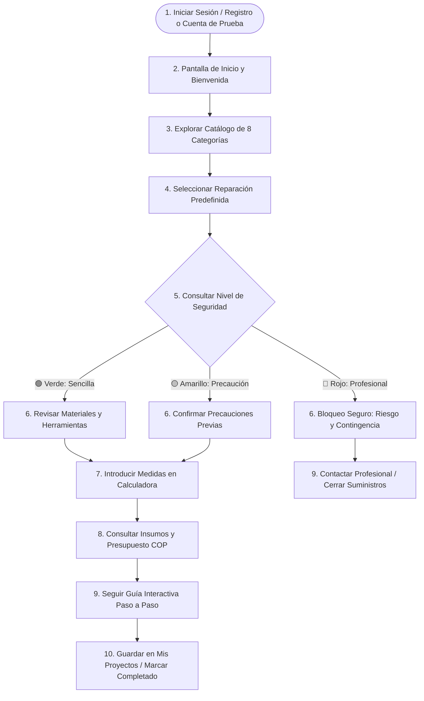
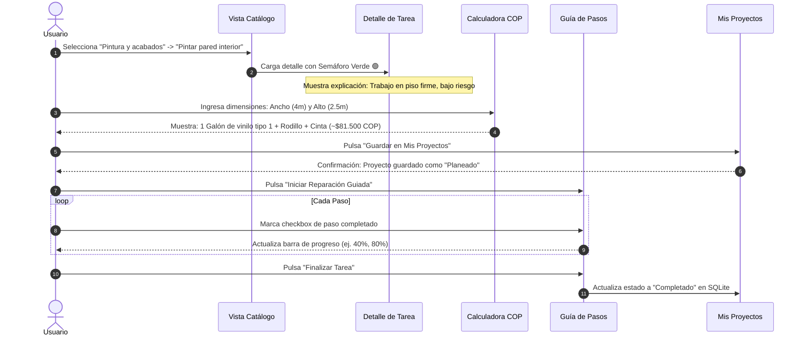
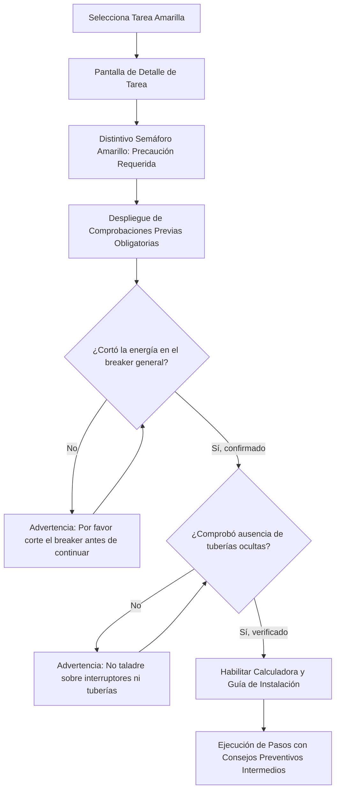
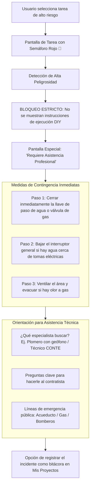
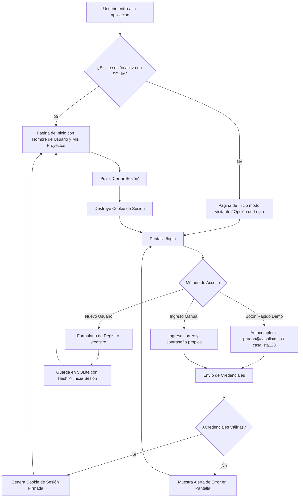

# CasaLista — Arquitectura de Flujos de Usuario (User Flows)

Este documento describe la navegación y los recorridos principales de los usuarios dentro de **CasaLista**, modelando visualmente cada bifurcación del sistema mediante diagramas de flujo Mermaid.

---

## 1. El Recorrido Central del Usuario (10 Pasos)

Conforme a la definición conceptual del proyecto, el ciclo de vida completo de la experiencia se resume en 10 etapas:



---

## 2. Flujo 1: Reparación Verde (Camino Guiado y Sencillo)
*Ejemplo: Pintar pared interior o resanar orificios.*



---

## 3. Flujo 2: Reparación Amarilla (Camino con Precaución Obligatoria)
*Ejemplo: Instalar repisa flotante con taladro o cambiar bombillo accesible.*



---

## 4. Flujo 3: Reparación Roja (Protocolo de Detención Segura)
*Ejemplo: Fuga de tubería empotrada, manipulación de caja de tacos o fuga de gas.*



---

## 5. Flujo 4: Autenticación y Gestión de Sesión



---

## 6. Mapa de Navegación del Sistema (Site Map)

```
CasaLista/
├── / (Inicio / Explorador de Categorías)
├── /login (Inicio de sesión con botón demo 1 clic)
├── /registro (Registro de nueva cuenta)
├── /logout (Cierre de sesión)
├── /categoria/{id} (Listado de reparaciones de la categoría con semáforo)
├── /tarea/{id} (Ficha de la tarea, semáforo explicativo, insumos y calculadora)
├── /tarea/{id}/guia (Guía interactiva paso a paso - Solo Verde y Amarillo)
├── /tarea/{id}/alerta-riesgo (Pantalla de contingencia y profesional - Solo Rojo)
├── /mis-proyectos (Gestor de proyectos del usuario: planeados, en proceso, completados y favoritos)
├── /mis-proyectos/nuevo (Acción de guardar proyecto desde calculadora)
├── /mis-proyectos/{id}/estado (Actualización de avance de proyecto)
└── /perfil (Ficha del usuario, estadísticas y créditos del proyecto académico)
```
